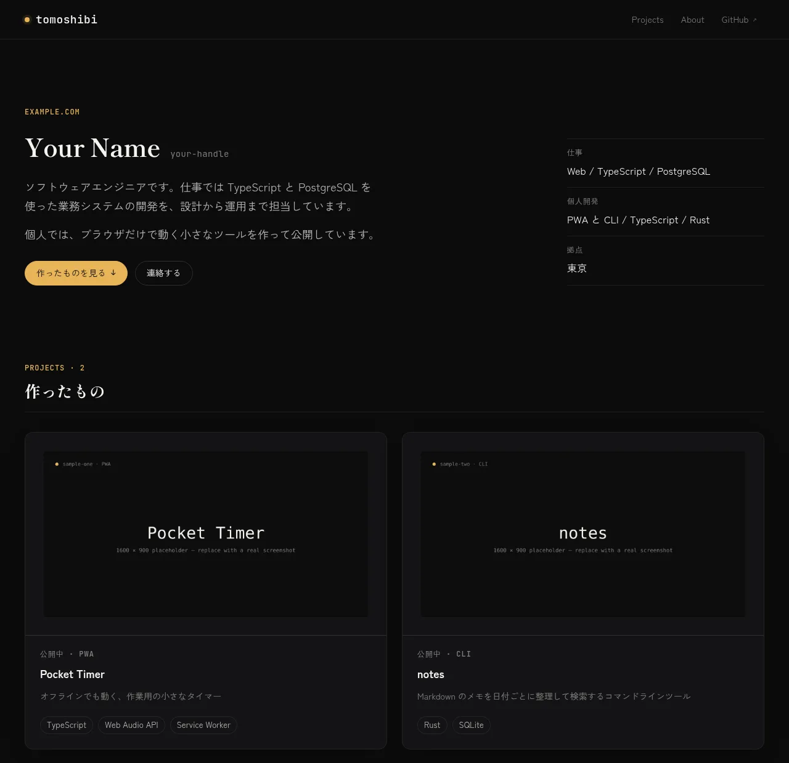

# Tomoshibi — 灯

A dark, zero-JavaScript Astro template for a personal site: the things you
built, a short bio, and a way to reach you. Japanese typography first, but
every string is yours to change.

**Demo:** https://tomoshibi.c12o.net · [日本語の説明はこちら](#日本語)



## Features

- **Astro 7, static output.** No framework, no client-side JavaScript. The only
  `<script>` on the site is JSON-LD for search engines.
- **Strict CSP out of the box.** `public/_headers` ships `default-src 'self'`
  with no inline styles or scripts to whitelist.
- **Dark-only design tokens.** One file (`src/styles/tokens.css`) defines every
  color, font, spacing and radius.
- **Japanese web fonts, subset and self-hosted.** `scripts/build-fonts.mjs`
  copies only the woff2 slices of Zen Kaku Gothic New and Shippori Mincho B1,
  so pages download the glyph ranges they use.
- **Project pages.** Each entry in `src/data/projects.ts` becomes a card on the
  home page and a page at `/projects/<slug>/`, with a cross-document view
  transition between the two.
- **Optional "latest posts".** Point `feedUrl` at any RSS 2.0 feed and the home
  page lists the newest entries at build time. Leave it `null` and the section
  disappears.
- **Generated metadata.** Sitemap, `robots.txt`, `security.txt`, canonical URLs,
  Open Graph tags and JSON-LD all derive from one config file.
- **Biome + GitHub Actions.** Lint, format, typecheck and build run in CI.

## Quick start

```bash
pnpm create astro@latest -- --template c12o-dev/tomoshibi my-site
cd my-site
pnpm install
pnpm dev
```

Or click **Use this template** on GitHub. Node 22.12 or newer is required.

## Customize

Everything you need to edit is in two files and a few images.

1. **`src/data/site.ts`** — set `url` first (the build fails without it), then
   `name`, `author`, `title`, `description`, `email`, `links`, the hero, about
   and contact copy, and the `ui` labels. To add a Blog entry to the header,
   uncomment the `nav` line and set `links.blog`.
2. **`src/data/projects.ts`** — your projects, newest first. Replace the two
   samples.
3. **`public/screenshots/*.webp`** — one 1600×900 image per project, named by
   slug.
4. **`public/favicon.svg`, `favicon.ico`, `apple-touch-icon.png`,
   `og-image.png`** — the placeholders are a plain amber dot. The OG image is
   1200×630; `docs/design/og/` has the page used to render it.
5. **`.github/workflows/scheduled-rebuild.yml`** — only needed with a blog
   feed; see below.

### Switching language

The site ships with Japanese copy and `lang: 'ja'`. For another language, set
`lang` and `ogLocale` in `site.ts` and translate the `ui` object. Components
contain no text of their own. The Japanese typesetting rules in `base.css`
(`line-break: strict`, `text-autospace`, `palt`) are harmless for Latin text.

### Blog feed

Set `feedUrl` to an RSS 2.0 feed (`<item>` with `title`, `link`, `pubDate`).
Atom is not supported. The feed is read once at build time with a 10 s timeout;
if it is unreachable, the section is omitted and the build still succeeds.
`links.blog` is used for the "view all" link, falling back to the feed's origin.

To keep the list fresh between pushes, add a deploy hook from your host as the
repository secret `DEPLOY_HOOK_URL`. `scheduled-rebuild.yml` calls it every day
at 06:00 JST and does nothing while the secret is unset. GitHub disables
scheduled workflows after 60 days without repository activity.

A matching blog template, **Tsurezure**, is in preparation.

### Fonts

To change fonts: install other `@fontsource/*` packages, list their CSS files
in `SOURCES` at the top of `scripts/build-fonts.mjs`, and update `--font-sans`
/ `--font-serif` in `src/styles/tokens.css`. JetBrains Mono is imported directly
in `src/layouts/Base.astro`. `FONT_DISPLAY=optional pnpm build` changes
`font-display` for the generated fonts.

## Deploy

`pnpm build` writes `dist/`. Deploy it to any static host.

The `SITE_URL` environment variable overrides `site.url` for one build, so a
preview or demo deployment can get correct canonical URLs without a code
change: `SITE_URL=https://preview.example.com pnpm build`.

- **Cloudflare Workers** — `wrangler.jsonc` is included (static assets,
  `404-page` handling). In Workers Builds set the build command to
  `pnpm run build` and the deploy command to `npx wrangler deploy`.
  `public/_headers` is honored. Workers Builds has no deploy hooks, so the
  scheduled rebuild below does not apply.
- **Cloudflare Pages, Netlify** — read `public/_headers` as is. The security
  headers and cache rules apply without further setup. Both offer deploy hooks.
- **Vercel** — ignores `_headers`. Copy the rules into `vercel.json`:

  ```json
  {
    "headers": [
      {
        "source": "/(.*)",
        "headers": [
          { "key": "Content-Security-Policy", "value": "default-src 'self'; script-src 'self'; style-src 'self'; img-src 'self' data:; font-src 'self'; connect-src 'self'; base-uri 'none'; form-action 'none'; frame-ancestors 'none'; object-src 'none'; upgrade-insecure-requests" },
          { "key": "X-Content-Type-Options", "value": "nosniff" },
          { "key": "Referrer-Policy", "value": "strict-origin-when-cross-origin" }
        ]
      }
    ]
  }
  ```

- **GitHub Pages** — cannot set custom headers. The site works, without the
  CSP.

`public/fonts/` is generated during `pnpm build` and is not committed. If you
upload `dist/` by hand, build locally first.

`Cross-Origin-Resource-Policy: same-site` in `_headers` stops other sites from
hot-linking your images. Remove that line if you want to allow it.

## Scripts

| Command           | What it does                                   |
| ----------------- | ---------------------------------------------- |
| `pnpm dev`        | Generate fonts, start the dev server           |
| `pnpm build`      | Generate fonts, build `dist/`                  |
| `pnpm preview`    | Serve `dist/` locally                          |
| `pnpm check`      | Biome lint and format check                    |
| `pnpm fix`        | Biome auto-fix                                 |
| `pnpm typecheck`  | `astro check`                                  |

The repository pins pnpm through `packageManager`. To use npm or yarn, delete
that field and `pnpm-lock.yaml`.

## License

MIT © 2026 [Seu](https://c12o.net). Issues and pull requests are welcome.

---

## 日本語

デモ: https://tomoshibi.c12o.net

個人サイト向けの Astro テンプレートです。作ったもの、経歴、連絡先を 1 ページに
まとめ、各プロジェクトに詳細ページを持たせます。ランタイム JavaScript はゼロで、
日本語組版を前提にデザインしています。

### 特徴

- Astro 7 の静的出力。フレームワークもクライアント JS も使いません
- `public/_headers` に厳格な CSP を同梱。inline の script / style を出さない前提
- デザイントークンは `src/styles/tokens.css` に集約。ダーク固定
- Zen Kaku Gothic New / Shippori Mincho B1 を `scripts/build-fonts.mjs` が
  woff2 のサブセットとして `public/fonts/` に生成
- `src/data/projects.ts` の各項目がカードと `/projects/<slug>/` になり、両者を
  View Transition でつなぐ
- `feedUrl` に RSS 2.0 を指定すると「最近の記事」をビルド時に取得。`null` なら
  セクションごと出ない
- sitemap / robots.txt / security.txt / OG / JSON-LD は設定ファイルから生成

### 使い方

```bash
pnpm create astro@latest -- --template c12o-dev/tomoshibi my-site
cd my-site
pnpm install
pnpm dev
```

編集するのは次のファイルだけです。

1. `src/data/site.ts` — まず `url` を設定する（未設定だとビルドが失敗する）。
   次に名前・説明・リンク・Hero / About / Contact の文言・`ui` のラベル
2. `src/data/projects.ts` — プロジェクト一覧。サンプル 2 件を置き換える
3. `public/screenshots/*.webp` — 1600×900、slug と同名
4. `public/favicon.svg` / `favicon.ico` / `apple-touch-icon.png` /
   `og-image.png` — OG 画像は 1200×630。`docs/design/og/` に生成用ページがある
5. `.github/workflows/scheduled-rebuild.yml` — ブログ連携を使うときだけ、ホストの
   Deploy Hook URL を secret `DEPLOY_HOOK_URL` に入れる

### デプロイ

`pnpm build` で `dist/` ができます。Cloudflare Workers 用の `wrangler.jsonc` を
同梱しています（Workers Builds のデプロイコマンドは `npx wrangler deploy`）。
Cloudflare Workers / Pages と Netlify は `public/_headers` をそのまま読みます。Vercel は `vercel.json` に書き写し、
GitHub Pages はカスタムヘッダを設定できません（CSP 無しで動きます）。
`public/fonts/` はビルド時に生成されるので、`dist/` を手で上げる場合は
ローカルでビルドしてください。環境変数 `SITE_URL` を設定すると、そのビルドだけ
`site.url` を上書きできます（プレビューやデモ用）。

ブログ側のテンプレート **Tsurezure** を準備中です。

### ライセンス

MIT © 2026 [Seu](https://c12o.net)
